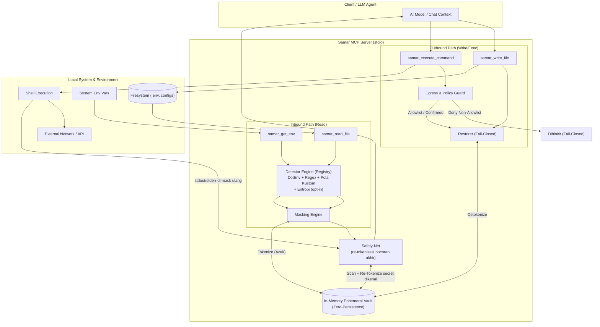

# Samar (Samar MCP Server)

[](https://github.com/hanifalkauni/samar-mcp/releases)
[](https://github.com/hanifalkauni/samar-mcp/actions/workflows/ci.yml)
[](https://golang.org)
[](./LICENSE)
[](./SECURITY.md)

[English](README.md) | **Bahasa Indonesia**

---

Samar adalah server MCP yang menyamarkan kredensial terdeteksi saat client membaca file atau environment melalui Samar. Nilainya diganti token reversibel yang disimpan di memori. Saat token dipakai untuk menulis file atau menjalankan shell command, Samar memulihkan nilai aslinya. Secara default, shell command yang membawa token meminta persetujuan melalui MCP elicitation. Pemeriksaan egress membaca teks command, jadi tidak dapat menjamin bahwa command tidak akan memakai jaringan.

> **Versi: v1.3.0.** Shell command bertoken meminta persetujuan secara default. Pemeriksaan egress bersifat heuristik, sedangkan audit log memakai rantai hash SHA-256 tanpa kunci.

---

## 🏗️ Alur Data & Arsitektur

*Diagram ini menunjukkan cara Samar menyamarkan secret yang terdeteksi saat membaca file dan environment, lalu memulihkan token saat menulis file atau menjalankan shell command. Sebelum merestorasi token untuk command, Samar memeriksa policy egress dan secara default meminta persetujuan.*



---

## 🚀 Panduan Cepat & Instalasi

Pilih cara instalasi, lalu daftarkan Samar di client MCP Anda.

### 1. Pasang Samar
Pilih salah satu metode berikut:

- **Via `go install` (Direkomendasikan):**
  ```bash
  go install github.com/hanifalkauni/samar-mcp/cmd/samar@latest
  ```
- **Binary Siap Pakai:** Unduh binary untuk Windows, macOS, atau Linux dari [GitHub Releases](https://github.com/hanifalkauni/samar-mcp/releases/latest) (cek `SHA256SUMS.txt` untuk verifikasi), lalu letakkan di dalam `PATH` sistem Anda.
- **Tanpa Instalasi (`go run`):** Jalankan setup atau server langsung tanpa install binary:
  ```bash
  go run github.com/hanifalkauni/samar-mcp/cmd/samar@latest setup all
  ```

### 2. Daftarkan Samar ke client
Perintah setup mendaftarkan Samar dan menambahkan aturan akses file serta panduan untuk client yang dipilih:

```bash
samar setup claude-code   # Claude Code: settings.json deny rules, guard hook, CLAUDE.md
samar setup kiro          # Kiro IDE: mcp.json, permissions.yaml deny rules, steering
samar setup cursor        # Cursor IDE: mcp.json, .cursorrules & samar.mdc
samar setup antigravity   # Antigravity/Gemini: mcp_config.json, rules/samar.md
samar setup all           # Setup semua client yang terdeteksi sekaligus
```

### 3. Uji masking dengan file contoh
Uji ini memeriksa pembacaan melalui Samar. Tool file bawaan client dapat melewati Samar jika aksesnya tidak dibatasi; lihat [Konfigurasi Manual Client](#-konfigurasi-manual-client-alternatif).

1. Buat file `.env` tiruan di workspace Anda:
   ```bash
   echo "TEST_SECRET=my_dummy_secret_token_123" > .env
   ```
2. Minta client membaca `.env` melalui tool Samar `samar_read_file`.
3. Hasilnya seharusnya memuat token seperti `__SAMAR_SECRET_1__`, bukan `my_dummy_secret_token_123`.

---

## 🔌 Konfigurasi Manual Client (Alternatif)

Jika ingin mengatur client sendiri atau menggunakan client tanpa perintah setup, mulai dari template di [`docs/clients/`](./docs/clients/) (`kiro.mcp.json`, `cursor.mcp.json`, `claude.mcp.json`, dan `allowlist.example`).

#### Opsi 1: Otomatis via `go run` (Tanpa Instalasi Manual)
Menjalankan Samar secara on-the-fly langsung dari repositori GitHub:
```json
{
  "mcpServers": {
    "samar": {
      "command": "go",
      "args": ["run", "github.com/hanifalkauni/samar-mcp/cmd/samar@latest"]
    }
  }
}
```

#### Opsi 2: Binary Terpasang di PATH
```json
{
  "mcpServers": {
    "samar": {
      "command": "samar",
      "args": []
    }
  }
}
```

#### Opsi 3: Path Binary Lokal
```json
{
  "mcpServers": {
    "samar": {
      "command": "/path/to/samar",
      "args": []
    }
  }
}
```

> **Wajib untuk konfigurasi manual:** Atur tool file bawaan client agar menolak akses ke file sensitif seperti `.env` dan `*.pem`. Jika tidak, tool tersebut dapat membaca file langsung tanpa melewati Samar. Lihat [`docs/CLIENT_CONFIG.id.md`](./docs/CLIENT_CONFIG.id.md). Untuk Kiro, ikuti [`docs/KIRO_SETUP.id.md`](./docs/KIRO_SETUP.id.md).

---

## ✨ Fitur

### Inbound (M0)
- `samar_read_file(path)` — membaca file, menyamarkan secret yang terdeteksi, lalu mengembalikan isinya.
- `samar_get_env(env_var?)` — membaca environment dan menyamarkan nilainya; nama variabel tetap terlihat.

### Outbound (M1)
- `samar_write_file(path, content)` — memulihkan token sebelum menulis. Jika token rusak atau terpotong, Samar membatalkan operasi dan mengembalikan error.
- `samar_execute_command(command, cwd?)` — secara default meminta persetujuan MCP elicitation sebelum memulihkan token dan menjalankan command. Proses shell memiliki timeout 30 detik; stdout dan stderr masing-masing dibatasi 1 MiB. Batas ini tidak mengisolasi proses atau akses jaringannya.
- **Pemeriksaan egress:** Samar memblokir URL non-allowlist yang terdeteksi dan utilitas jaringan tertentu yang tujuannya tidak dapat dikenali. Pemeriksaan teks command bersifat heuristik; pemeriksaan ini tidak dapat membuktikan bahwa command hanya bekerja lokal. Jika client tidak mendukung elicitation, persetujuan gagal tertutup. `SAMAR_REQUIRE_CONFIRM=off` secara eksplisit melewati persetujuan.
- **Egress allowlist bertingkat (§13.3):** `global ∪ per-project`, lazy reload tanpa restart (§13.5).

### Inti
- Vault token↔secret dua-arah, in-memory, token **acak** (bukan hash nilai) + reverse-map determinisme.
- Detektor: parser `.env*` (mask semua value) + rule-set regex (AWS, GitHub, OpenAI, Slack, Stripe, Google, JWT, DB URI, private key, variabel generik).
- **Pola kustom (hot-reload):** Tambahkan format secret di file teks; Samar tidak perlu dikompilasi ulang. Tulis satu regex per baris. Baris kosong dan baris yang diawali `#` diabaikan. Jika pola memiliki grup tangkap bernama `secret`, Samar hanya menyamarkan grup itu; jika tidak, seluruh match disamarkan. Pola yang rusak dilewati. Jika file tidak bisa dibaca, Samar mempertahankan pola yang sudah dimuat. Samar memeriksa perubahan setiap lima detik.
  - Global: `~/.samar/patterns` (fallback: `~/.safeenv/patterns`)
  - Per-project: `./.samar/patterns` (fallback: `./.safeenv/patterns`)
  - Contoh file `patterns`:
    ```text
    # Token deploy internal: ACME- diikuti 10 digit
    ACME-[0-9]{10}
    # Mask hanya value setelah "internal_key:"
    internal_key:\s*(?P<secret>[A-Z0-9]{8,})
    ```
- **Deteksi entropi (opt-in, `SAMAR_ENTROPY=1`):** Mendeteksi token berentropi tinggi tanpa kata kunci secret di luar file `.env`. Detektor memakai entropi Shannon per kata dan melewati nilai pendek, UUID, angka, serta kata umum. Fitur ini nonaktif secara default karena dapat menandai hash dan string base64.
- **Deteksi PII (opt-in, `SAMAR_PII=1`):** Mendeteksi alamat email, nomor kartu kredit, IBAN, dan IPv4. Samar memvalidasi kartu dengan Luhn, IBAN dengan mod-97, dan rentang oktet IPv4. Fitur ini nonaktif secara default karena pola PII dapat menghasilkan false-positive.
- **Safety-net runtime (selalu aktif):** Sebelum mengembalikan hasil tool, Samar memeriksa apakah output berisi secret yang sudah tersimpan di vault. Jika ditemukan, Samar menggantinya dengan token yang sama dan mencatat event `leak_patched` di audit log.

---

## ⚙️ Variabel Lingkungan

| Variabel | Opsi / Nilai | Default | Deskripsi |
| :--- | :--- | :--- | :--- |
| `SAMAR_AUDIT_DIR` | Path direktori | `~/.samar/audit/<project-slug>-<hash8>/` | Direktori log audit kustom (override). File dan direktori dibuat secara *lazy* saat event pertama ditulis (sesi idle tidak membuat file kosong). (Dukungan mundur: `SAFEENV_AUDIT_DIR`). |
| `SAMAR_STRICT_ALLOWLIST` | `1` / `0` | `0` (union) | Jika `1`, egress allowlist per-project mempersempit global (`global ∩ project`). Default: penggabungan (`global ∪ project`). (Dukungan mundur: `SAFEENV_STRICT_ALLOWLIST`). |
| `SAMAR_REQUIRE_CONFIRM` | `""`, `"off"`, `"elicit"`, `"deny"` | `"elicit"` | Persetujuan sebelum command shell yang membawa secret hasil restorasi: `""` / `"elicit"` meminta persetujuan MCP elicitation (gagal tertutup bila client tidak mendukung); `"off"` secara eksplisit auto-approve command bertoken dan berisiko untuk secret asli; `"deny"` menolak semua command bertoken. `SAFEENV_REQUIRE_CONFIRM` tetap didukung. |
| `SAMAR_ENTROPY` | `1` / `0` | `0` (off) | Jika `1`, aktifkan deteksi entropi Shannon (opt-in) untuk token telanjang berentropi tinggi (tanpa kata-kunci, non-`.env`). Bisa menambah false-positive pada hash/UUID/base64. (Dukungan mundur: `SAFEENV_ENTROPY`). |
| `SAMAR_PII` | `1` / `0` | `0` (off) | Jika `1`, aktifkan deteksi PII (opt-in): email, kartu kredit (Luhn), IBAN (mod-97), IPv4 (rentang oktet). Bisa menambah false-positive. (Dukungan mundur: `SAFEENV_PII`). |

---

## 🏛️ Arsitektur (SOLID)

Setiap lapisan bergantung ke **interface**, bukan tipe konkret; implementasi
dirakit hanya di `cmd/samar/main.go`.

```text
cmd/samar              composition root — wiring satu-satunya
internal/vault         penyimpanan secret↔token in-memory (SRP)
internal/idgen         TokenGenerator berbasis crypto/rand
internal/detector      Detector interface + Registry (ISP, OCP) + dotenv, regex, custom (hot-reload), entropi & PII (opt-in)
internal/masking       Engine: detect→tokenize→replace, bergantung abstraksi (DIP)
internal/restore       Restorer: token→secret, fail-closed pada token korup (M1)
internal/policy        Policy exfiltration/confused-deputy, fail-closed (M1)
internal/allowlist     Egress allowlist bertingkat + lazy reload (M1)
internal/leakscan      Safety-net runtime: scan output tool + re-tokenisasi bocoran dikenal
internal/safeio        abstraksi FileReader/EnvReader/FileWriter/CommandRunner (DIP)
internal/server        registrasi & handler 4 tool MCP, bergantung interface
```

---

## 📂 Struktur Repositori

```text
samar-mcp/
├── cmd/
│   └── samar/               # Composition root & entry point binary MCP
├── internal/
│   ├── allowlist/           # Multi-layer egress allowlist & lazy reload
│   ├── audit/               # Audit logger JSONL dengan rantai hash SHA-256 tanpa kunci
│   ├── detector/            # Scanner kredensial (DotEnv parser & Regex rules)
│   ├── idgen/               # Generator ID token acak (crypto/rand)
│   ├── masking/             # Engine sanitasi inbound (detect -> tokenize -> replace)
│   ├── policy/              # Evaluasi egress exfiltration & confused-deputy guard
│   ├── restore/             # Engine unmask outbound dengan fail-closed verification
│   ├── safeio/              # Abstraksi I/O (FileReader, EnvReader, CommandRunner)
│   ├── server/              # Registrasi dan handler 4 tool MCP
│   └── vault/               # Penyimpanan dua-arah secret ↔ token in-memory
├── docs/
│   ├── clients/             # Template konfigurasi client (Kiro, Cursor, Claude)
│   ├── BYPASS_TEST.md       # Prosedur uji pencegahan bypass manual
│   ├── CLIENT_CONFIG.md     # Panduan setup deny-selektif tool bawaan client
│   └── PRD.md               # Dokumen historis rasionale desain (frozen)
├── scripts/                 # Skrip otomasi build rilis multi-platform
└── test/
    └── canary/              # Canary test harness untuk verifikasi batas proteksi
```

---

## 🧪 Build & Test

```bash
go build -o bin/samar ./cmd/samar       # binary
go test -race ./...                      # unit test + race detector
go vet ./...
```

Canary harness menanam penanda unik di beberapa jenis file, menjalankan tool Samar melalui MCP, lalu memeriksa kebocoran yang tidak terduga:
```bash
go build -o bin/samar ./cmd/samar
go run ./test/canary        # exit 0 = tak ada kebocoran tak terduga
```
Untuk setiap fixture, harness melaporkan `PROTECTED`, `EXPECTED-LEAK` (batas yang diketahui), atau `UNEXPECTED-LEAK`. Harness hanya memeriksa permintaan yang melewati Samar. Harness tidak memeriksa apakah client dapat membaca file dengan tool bawaannya; ikuti [`docs/BYPASS_TEST.id.md`](./docs/BYPASS_TEST.id.md) untuk pengujian itu.

---

## 🔒 Keamanan

- **Zero-Persistence:** Vault strictly in-memory; hangus seketika saat proses berhenti. Tidak ada tool untuk unmask dari sisi LLM.
- **Anti-Brute Force:** Token acak tidak diturunkan dari nilai asli (bukan hash).
- **Perlindungan DoS:** File lebih dari 10 MB ditolak. Proses shell memiliki timeout 30 detik; stdout dan stderr dibatasi masing-masing 1 MiB. Proses turunan tidak dijamin ikut dihentikan.

---

## ❓ FAQ & Troubleshooting

<details>
<summary><b>Bagaimana jika token placeholder termutasi atau terpotong oleh LLM?</b></summary>

Jika token diubah atau terpotong, Samar tidak dapat memulihkannya. `samar_write_file` dan `samar_execute_command` mengembalikan error alih-alih melanjutkan dengan nilai yang rusak atau tidak lengkap.
</details>

<details>
<summary><b>Mengapa AI masih bisa membaca nilai asli di file .env saya?</b></summary>

Samar hanya menyamarkan pembacaan yang melewati tool-nya. Atur **deny-selektif** untuk tool file bawaan client (seperti `fs_read` atau `Read`) agar tool tersebut tidak dapat membaca file sensitif langsung. Lihat [`docs/CLIENT_CONFIG.id.md`](./docs/CLIENT_CONFIG.id.md).
</details>

<details>
<summary><b>Apakah perlu me-restart server Samar saat memperbarui file allowlist?</b></summary>

Tidak. Samar memeriksa allowlist global (`~/.samar/allowlist`) dan project (`./.samar/allowlist`) setiap lima detik, lalu memuat ulang file yang berubah.
</details>

<details>
<summary><b>Apakah secret asli ikut dicatat ke dalam log audit?</b></summary>

Tidak. Audit log berisi metadata event, bukan secret mentah. Secara default, file disimpan di `~/.samar/audit/<project-slug>-<hash8>/`; gunakan `SAMAR_AUDIT_DIR` untuk memilih direktori lain. Setiap log memakai rantai hash SHA-256 tanpa kunci. Rantai ini dapat membantu menemukan perubahan sebagian atau tidak sengaja, tetapi siapa pun yang dapat menulis ulang file juga dapat menghitung ulang rantainya. Samar melaporkan kegagalan tulis ke stderr, dan kegagalan itu dapat membuat log tidak lengkap.
</details>

## 🤝 Kontribusi & Keamanan

- **Kontribusi:** Lihat [CONTRIBUTING.md](./CONTRIBUTING.md) untuk panduan pengembangan dan pull request.
- **Keamanan:** Lihat [SECURITY.md](./SECURITY.md) untuk melaporkan kerentanan dan memahami cakupan keamanan proyek.

---

## 📄 Lisensi

SPDX-License-Identifier: MIT

Proyek ini dilisensikan di bawah [MIT License](./LICENSE).
