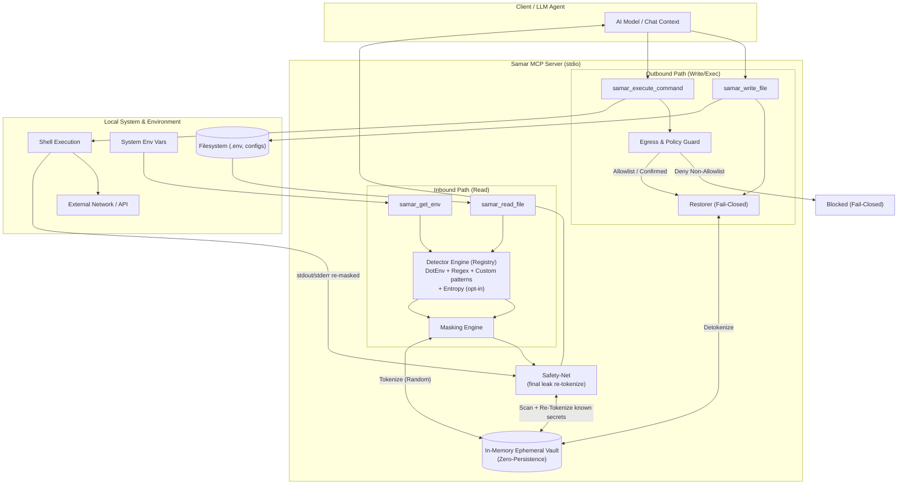

# Samar (Samar MCP Server)

[](https://github.com/hanifalkauni/samar-mcp/releases)
[](https://github.com/hanifalkauni/samar-mcp/actions/workflows/ci.yml)
[](https://golang.org)
[](./LICENSE)
[](./SECURITY.md)

**English** | [Bahasa Indonesia](README.id.md)

---

Samar is an MCP server that masks detected credentials when a client reads files or environment variables through Samar. It replaces them with reversible tokens held in memory. When a token is used in a file write or shell command, Samar restores the original value. By default, shell commands containing tokens require approval through MCP elicitation. Egress checks inspect command text, so they cannot guarantee that a command will not use the network.

> **Version: v1.3.0.** Token-bearing shell commands require approval by default. Egress checks are heuristic, and the audit log uses an unkeyed SHA-256 hash chain.

---

## 🏗️ Data Flow & Architecture

*The diagram shows how Samar masks detected secrets on reads and restores tokens on writes and shell commands. Before restoring tokens for a shell command, Samar checks its egress policy and asks for approval by default.*



---

## 🚀 Quickstart & Installation

Choose an installation method, then register Samar with your MCP client.

### 1. Install Samar
Choose one method:

- **Via `go install` (Recommended):**
  ```bash
  go install github.com/hanifalkauni/samar-mcp/cmd/samar@latest
  ```
- **Pre-built Binary:** Download the executable for Linux, macOS, or Windows from [GitHub Releases](https://github.com/hanifalkauni/samar-mcp/releases/latest) (refer to `SHA256SUMS.txt` for verification) and place it in your `PATH`.
- **Zero Installation (`go run`):** Run setup or start the server directly without installing:
  ```bash
  go run github.com/hanifalkauni/samar-mcp/cmd/samar@latest setup all
  ```

### 2. Register Samar with your client
The setup command registers Samar and adds the supported client's file-access rules and guidance files:

```bash
samar setup claude-code   # Claude Code: settings.json deny rules, guard hook, CLAUDE.md
samar setup kiro          # Kiro IDE: mcp.json, permissions.yaml deny rules, steering
samar setup cursor        # Cursor IDE: mcp.json, .cursorrules & samar.mdc
samar setup antigravity   # Antigravity/Gemini: mcp_config.json, rules/samar.md
samar setup all           # Setup all supported AI clients in one command
```

### 3. Check masking with a test file
This test checks reads through Samar. A client's built-in file tools can bypass Samar unless you restrict them; see [Manual Client Configuration](#-manual-client-configuration-alternative).

1. Create a dummy test `.env` file in your workspace:
   ```bash
   echo "TEST_SECRET=my_dummy_secret_token_123" > .env
   ```
2. Ask your client to read `.env` through Samar's `samar_read_file` tool.
3. The result should contain a masked token such as `__SAMAR_SECRET_1__`, not `my_dummy_secret_token_123`.

---

## 🔌 Manual Client Configuration (Alternative)

If you want to configure a client yourself, or use one without a setup command, start with the templates in [`docs/clients/`](./docs/clients/) (`kiro.mcp.json`, `cursor.mcp.json`, `claude.mcp.json`, and `allowlist.example`).

#### Option 1: On-the-fly via `go run` (Zero Installation)
Runs Samar on-the-fly directly from the GitHub repository:
```json
{
  "mcpServers": {
    "samar": {
      "command": "go",
      "args": ["run", "github.com/hanifalkauni/samar-mcp/cmd/samar@latest"]
    }
  }
}
```

#### Option 2: Pre-installed Binary (in PATH)
```json
{
  "mcpServers": {
    "samar": {
      "command": "samar",
      "args": []
    }
  }
}
```

#### Option 3: Local Binary Path
```json
{
  "mcpServers": {
    "samar": {
      "command": "/path/to/samar",
      "args": []
    }
  }
}
```

> **Required for manual setup:** Configure the client's built-in file tools to deny access to sensitive files such as `.env` and `*.pem`. Otherwise, those tools can read the files directly and bypass Samar. See [`docs/CLIENT_CONFIG.md`](./docs/CLIENT_CONFIG.md). For Kiro, follow [`docs/KIRO_SETUP.md`](./docs/KIRO_SETUP.md).

---

## ✨ Features

### Inbound (M0)
- `samar_read_file(path)` — reads local file, masks sensitive secrets, returns sanitized content.
- `samar_get_env(env_var?)` — reads environment variables with masked values (variable keys remain visible).

### Outbound (M1)
- `samar_write_file(path, content)` — restores tokens before writing. If a token is corrupted or truncated, Samar stops and returns an error.
- `samar_execute_command(command, cwd?)` — by default, asks for MCP elicitation approval before restoring tokens and running the command. Samar applies a 30-second timeout to the shell process and caps stdout and stderr at 1 MiB each. These limits do not isolate the process or its network access.
- **Egress checks:** Samar blocks detected URLs outside the allowlist and known network tools whose destination it cannot identify. Command-text checks are heuristic and cannot prove a command is local-only. Approval fails closed when a client lacks elicitation support; `SAMAR_REQUIRE_CONFIRM=off` explicitly skips approval.
- **Multi-layer egress allowlist (§13.3):** `global ∪ per-project`, hot lazy-reloading without restarts (§13.5).

### Core Engine
- Two-way in-memory token↔secret vault, using **cryptographically random** tokens (not value hashes) with reverse-mapping for session determinism.
- Detectors: `.env*` parser (masks all values) + regex rule-set (AWS, GitHub, OpenAI, Slack, Stripe, Google, JWT, database URIs, private keys, generic assignments).
- **Custom patterns (user-defined, hot-reload):** Add secret formats in a plain-text file; no rebuild is needed. Put one regex on each line. Blank lines and lines starting with `#` are ignored. If a pattern has a named `secret` capture group, Samar masks that group; otherwise it masks the full match. Invalid patterns are skipped. If Samar cannot read the file, it keeps the last loaded patterns. Samar checks for changes every five seconds.
  - Global: `~/.samar/patterns` (fallback: `~/.safeenv/patterns`)
  - Per-project: `./.samar/patterns` (fallback: `./.safeenv/patterns`)
  - Example `patterns` file:
    ```text
    # Internal deploy token: ACME- followed by 10 digits
    ACME-[0-9]{10}
    # Mask only the value after "internal_key:"
    internal_key:\s*(?P<secret>[A-Z0-9]{8,})
    ```
- **Entropy detection (opt-in, `SAMAR_ENTROPY=1`):** Detects high-entropy tokens without secret-related keywords outside `.env` files. It uses Shannon entropy over whitespace-delimited words and skips short values, UUIDs, numbers, and common words. It is off by default because it can flag hashes and base64 strings.
- **PII detection (opt-in, `SAMAR_PII=1`):** Detects email addresses, credit-card numbers, IBANs, and IPv4 addresses. Samar validates card numbers with Luhn, IBANs with mod-97, and IPv4 octets by range. It is off by default because these patterns can produce false positives.
- **Runtime leak safety-net (always on):** Before returning a tool result, Samar checks it for secrets already in the vault. If it finds one, it replaces it with the same token and records a `leak_patched` audit event.

---

## ⚙️ Environment Variables

| Variable | Values / Options | Default | Description |
| :--- | :--- | :--- | :--- |
| `SAMAR_AUDIT_DIR` | Directory path | `~/.samar/audit/<project-slug>-<hash8>/` | Custom audit log directory. Files and directories are created lazily upon the first logged event (idle sessions produce 0 files). (Backward-compatible fallback: `SAFEENV_AUDIT_DIR`). |
| `SAMAR_STRICT_ALLOWLIST` | `1` / `0` | `0` (union) | When set to `1`, per-project allowlist narrows the global allowlist (`global ∩ project`). Default: union merge (`global ∪ project`). (Backward-compatible fallback: `SAFEENV_STRICT_ALLOWLIST`). |
| `SAMAR_REQUIRE_CONFIRM` | `""`, `"off"`, `"elicit"`, `"deny"` | `"elicit"` | Approval before any shell command containing restored secrets:<br>• `""` / `"elicit"`: request approval via MCP elicitation (fail-closed if the client lacks support).<br>• `"off"`: explicitly auto-approve token-bearing commands; unsafe with real secrets.<br>• `"deny"`: reject all token-bearing commands.<br>(Backward-compatible fallback: `SAFEENV_REQUIRE_CONFIRM`). |
| `SAMAR_ENTROPY` | `1` / `0` | `0` (off) | When `1`, enables opt-in Shannon-entropy detection of bare high-entropy tokens (no keyword, non-`.env`). May increase false positives on hashes/UUIDs/base64. (Backward-compatible fallback: `SAFEENV_ENTROPY`). |
| `SAMAR_PII` | `1` / `0` | `0` (off) | When `1`, enables opt-in PII detection: email, credit card (Luhn), IBAN (mod-97), IPv4 (octet range). May increase false positives. (Backward-compatible fallback: `SAFEENV_PII`). |

---

## 🏛️ Architecture (SOLID)

Every component depends on **interfaces**, not concrete types; implementations are wired strictly in `cmd/samar/main.go`.

```text
cmd/samar              composition root — sole dependency wiring location
internal/vault         in-memory secret↔token storage (SRP)
internal/idgen         TokenGenerator backed by crypto/rand
internal/detector      Detector interface + Registry (ISP, OCP) + dotenv, regex, custom (hot-reload), entropy & PII (opt-in)
internal/masking       Masking Engine: detect→tokenize→replace, depends on abstractions (DIP)
internal/restore       Restorer: token→secret, fail-closed on corrupt tokens (M1)
internal/policy        Exfiltration & confused-deputy policy, fail-closed (M1)
internal/allowlist     Layered egress allowlist + hot lazy reload (M1)
internal/leakscan      Runtime safety-net: scan tool output + re-tokenize known leaks
internal/safeio        FileReader/EnvReader/FileWriter/CommandRunner abstractions (DIP)
internal/server        MCP tool registration & dispatch handlers (DIP)
```

---

## 📂 Repository Structure

```text
samar-mcp/
├── cmd/
│   └── samar/               # Composition root & MCP binary entry point
├── internal/
│   ├── allowlist/           # Multi-layer egress allowlist & lazy reload
│   ├── audit/               # JSONL audit logger with an unkeyed SHA-256 hash chain
│   ├── detector/            # Secret scanner (DotEnv parser & Regex rulesets)
│   ├── idgen/               # Random token ID generator (crypto/rand)
│   ├── masking/             # Inbound sanitization engine (detect -> tokenize -> replace)
│   ├── policy/              # Egress exfiltration guard & confused-deputy policy
│   ├── restore/             # Outbound unmask engine with fail-closed integrity checks
│   ├── safeio/              # I/O abstractions (FileReader, EnvReader, CommandRunner)
│   ├── server/              # MCP tool registration and request handlers
│   └── vault/               # Two-way in-memory secret ↔ token store
├── docs/
│   ├── clients/             # Pre-configured client configs (Kiro, Cursor, Claude)
│   ├── BYPASS_TEST.md       # Manual canary bypass-prevention testing guide
│   ├── CLIENT_CONFIG.md     # Setup guide for selective-deny on built-in tools
│   └── PRD.md               # Historical design rationale document (frozen)
├── scripts/                 # Multi-platform release build automation scripts
└── test/
    └── canary/              # Canary test harness verifying masking boundaries
```

---

## 🧪 Build & Test

```bash
go build -o bin/samar ./cmd/samar       # compile binary
go test -race ./...                      # unit tests with race detector
go vet ./...
```

The canary harness plants unique markers in several file types, exercises Samar through MCP, and checks for unexpected leaks:
```bash
go build -o bin/samar ./cmd/samar
go run ./test/canary        # exit 0 = no unexpected leaks
```
For each fixture, the harness reports `PROTECTED`, `EXPECTED-LEAK` (a known limit), or `UNEXPECTED-LEAK`. It only checks requests that pass through Samar. It does not check whether a client can read files with its own tools; see [`docs/BYPASS_TEST.md`](./docs/BYPASS_TEST.md) for that test.

---

## 🔒 Security Model

- **Zero-Persistence:** Vault is strictly in-memory; completely destroyed upon process termination. No MCP tool exists to unmask values from the LLM side.
- **Anti-Brute Force:** Random tokens do not leak original secret contents or hashes.
- **DoS Guards:** Files exceeding 10 MB are rejected. Shell processes have a 30-second timeout, with stdout and stderr capped at 1 MiB each. This does not guarantee cleanup of child processes.

---

## ❓ FAQ & Troubleshooting

<details>
<summary><b>What happens if an LLM truncates or corrupts a secret token?</b></summary>

If a token is changed or cut off, Samar cannot restore it. `samar_write_file` and `samar_execute_command` return an error instead of continuing with a partial or invalid value.
</details>

<details>
<summary><b>Why can my AI assistant still read raw secrets from my .env file?</b></summary>

Samar only masks reads made through its tools. Configure **selective-deny** for the client's built-in file tools (such as `fs_read` or `Read`) so they cannot read sensitive files directly. See [`docs/CLIENT_CONFIG.md`](./docs/CLIENT_CONFIG.md).
</details>

<details>
<summary><b>Do I need to restart Samar when modifying the allowlist?</b></summary>

No. Samar checks the global (`~/.samar/allowlist`) and project (`./.samar/allowlist`) files every five seconds and reloads them when they change.
</details>

<details>
<summary><b>Are raw secrets recorded in the audit logs?</b></summary>

No. Audit logs contain event metadata, not raw secrets. Samar stores them under `~/.samar/audit/<project-slug>-<hash8>/` by default, or in the directory set by `SAMAR_AUDIT_DIR`. Each log uses an unkeyed SHA-256 hash chain. It can help reveal accidental or partial edits, but anyone who can rewrite the file can recompute the chain. Samar reports write failures to stderr, and a failure can leave the log incomplete.
</details>

## 🤝 Contributing & Security

- **Contributing:** See [CONTRIBUTING.md](./CONTRIBUTING.md) for development and pull request instructions.
- **Security:** See [SECURITY.md](./SECURITY.md) for reporting vulnerabilities and the project's security scope.

---

## 📄 License

SPDX-License-Identifier: MIT

This project is licensed under the [MIT License](./LICENSE).
